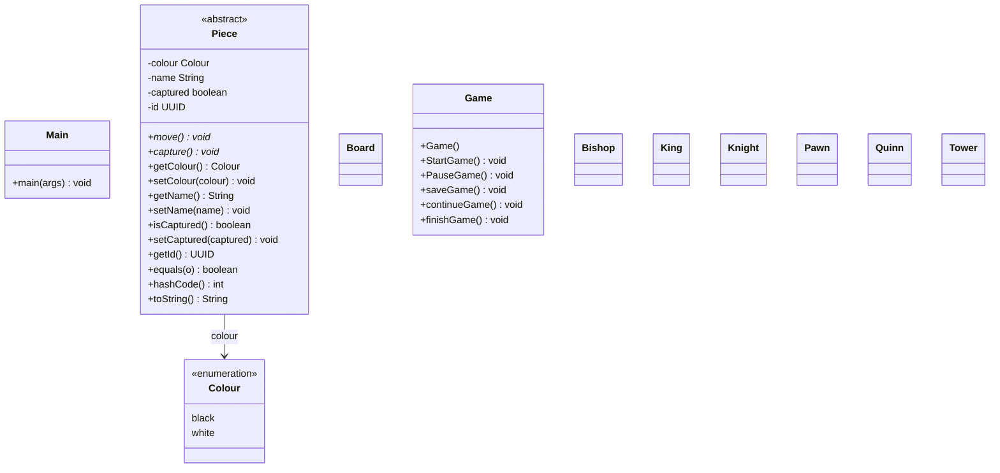

# SimpleChess


SimpleChess is the Java structure Nicolás Iavicoli Dulcet started for a chess game. It names the domain: a colour, an abstract piece, a board, a game lifecycle, and a class for each piece kind. The program compiles, and `Main` prints a one-line greeting.

## What is implemented

| Area | In the source today |
| --- | --- |
| Rules | No chess rules. The tree has no check, checkmate, castling, en passant, promotion, or turn order. |
| Move validation | `Piece` declares abstract `move()` and `capture()`. No class implements them. No code checks a square, a path, or a destination. |
| User interface | A console greeting. `Main` prints `Hello and welcome!` with `printf` and does not read input. The project has no Swing, JavaFX, or web UI. |
| Game lifecycle | `Game` declares `StartGame()`, `PauseGame()`, `saveGame()`, `continueGame()`, and `finishGame()`. Every body is empty. |
| Board | `Board` is an empty class: no squares, no pieces, no methods. |
| Pieces | `Colour` is the enum `black`, `white`. `Piece` stores a colour, a static name, a captured flag, and a `UUID`. `Bishop`, `King`, `Knight`, `Pawn`, `Quinn`, and `Tower` are empty classes. |

`Main` does not construct a `Game`, a `Board`, or a piece.

## Object-oriented design

Layout under the IntelliJ source root `src`:

```text
src/
  Main.java                  default package; entry point
  Enum/Colour.java           black, white
  Model/Board.java           board type, empty
  Model/Game.java            lifecycle methods, empty bodies
  Model/Piece.java           abstract piece
  Model/Pieces/Bishop.java
  Model/Pieces/King.java
  Model/Pieces/Knight.java
  Model/Pieces/Pawn.java
  Model/Pieces/Quinn.java
  Model/Pieces/Tower.java
```



`Piece` → `Colour` is the only type relationship written in the fields. `name`, `getName()`, and `setName()` are `static`, so the name is one value on the class. `equals` and `hashCode` use `id` only, via `Objects.equals` and `Objects.hashCode`, and `equals` uses an `instanceof` pattern (`Piece piece`). No constructor or setter assigns `id`. `Piece` is abstract, and no class extends it, so this source never constructs a `Piece`.

`Bishop` imports `Model.Piece` and does not use that import. `King`, `Knight`, `Pawn`, `Quinn`, and `Tower` do not reference `Piece`.

## Tech stack

- Java. `Piece.equals` uses `instanceof` pattern matching, which the language has had since Java 16. The commands below were run with OpenJDK 21.0.13.
- IntelliJ IDEA module `SimpleChess`. The project display name in `.idea/.name` is “Simple Chess”. `.idea/misc.xml` sets `languageLevel` to `JDK_24`, `project-jdk-name` to `24`, and the compiler output to `out/`.
- JDK library types only: `java.util.Objects` and `java.util.UUID`. There is no Maven build, no Gradle build, and no test source.

## Build and run

Verified on 22 November 2026 with OpenJDK 21.0.13.0.3 (Ubuntu build `21.0.13.0.3+1-1-24.04.1-Ubuntu`), from the repository root, in bash:

```bash
mkdir -p out
javac -d out $(find src -name '*.java' | sort)
java -cp out Main
```

`javac` exits 0. `java` exits 0 and writes exactly these 18 bytes, with no trailing newline:

```text
Hello and welcome!
```

`out/` is already ignored by `.gitignore`, and `*.class` is ignored as well. The version lines, exit codes, and byte dump are in [`docs/build-and-run.txt`](docs/build-and-run.txt).

The IntelliJ module uses `src` as its source folder and `Main` as the class with `main`. Opening the project in IntelliJ IDEA and running `Main` was not part of this check.

## Technical notes

- `Piece` keeps `colour`, `captured`, and `id` private, and exposes them through accessors. `captured` is a `boolean`, so it starts as `false`. `colour` and `id` start as `null`, and the static `name` starts as `null`, because no statement assigns them.
- `toString()` prints `colour`, `captured`, and `id`. It omits `name`.
- `Game` is the place the lifecycle is named: start, pause, save, continue, finish. `StartGame` and `PauseGame` are capitalized; `saveGame`, `continueGame`, and `finishGame` are not. The source uses those spellings.
- `Main` is in the default package, so the launch name is `Main`.
- Packages are `Enum`, `Model`, and `Model.Pieces`.
- The concrete piece classes are named `Bishop`, `King`, `Knight`, `Pawn`, `Quinn`, and `Tower`.

## Credits

- Repository owner: [Nicolás Iavicoli Dulcet](https://github.com/iavicoliNicolas) (`iavicoliNicolas`), junior developer and Computer Engineering student in Mar del Plata, Argentina.
- GitHub repository [`iavicoliNicolas/SimpleChess`](https://github.com/iavicoliNicolas/SimpleChess), created on 26 August 2024.
- Before this document, `main` contained one commit: [`3859812`](https://github.com/iavicoliNicolas/SimpleChess/commit/3859812b2173eca6a292c2f67937fe332dec558a) (“Primer commit, estructura basica”), authored by NyoSwat `<nicolaseliavicoli@gmail.com>` on 22 November 2025, 04:36:23 UTC−3.

## Resumen

SimpleChess es la estructura inicial en Java de un juego de ajedrez. El código define el color (`black`, `white`), una pieza abstracta (color, nombre estático, captura y `UUID`), un tablero vacío y una partida con `StartGame`, `PauseGame`, `saveGame`, `continueGame` y `finishGame`, todos sin cuerpo. Las clases `Bishop`, `King`, `Knight`, `Pawn`, `Quinn` y `Tower` están vacías y no extienden `Piece`. No hay reglas ni validación de movimientos. La única salida es la consola: `Hello and welcome!`. El proyecto es un módulo de IntelliJ IDEA con nivel de lenguaje JDK 24; la compilación y la ejecución se comprobaron con OpenJDK 21 el 22 de noviembre de 2026. El commit inicial es de NyoSwat, el 22 de noviembre de 2025.
